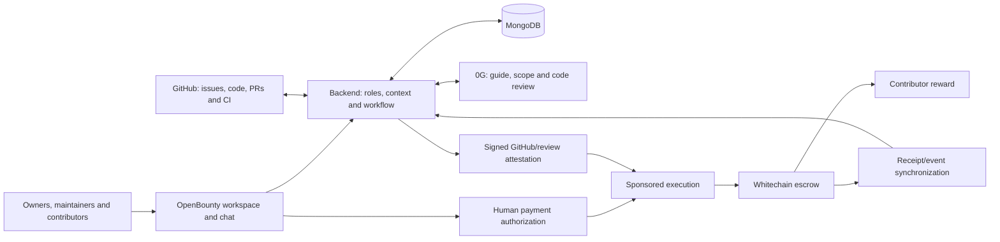

# OpenBounty — Project Overview

**ETHGlobal Mumbai 2026 · Team of four · Updated 5 November 2026**

> A shared workspace for open-source projects, where contributors collaborate with project-aware AI agents, get code reviewed against clear expectations, and receive funded bounty rewards.

**Tagline:** Contribute to open source. Get rewarded for impact.

**Selected tracks:** 0G — Build with 0G Private Computer; Whitechain — Scale · Payments Nobody Notices.

This document describes the proposed MVP and its completion requirements. Features and integrations below are planned, not claims of an existing implementation. It supersedes the earlier Arkiv-based architecture: Arkiv is removed entirely.

## 1. Product vision

OpenBounty gives an open-source repository a central place for its people, tasks and AI assistance. A contributor can understand the project, discuss an issue with maintainers, ask the project agent for help, and receive a review of their contribution in the same workspace.

The core product is the connection between **project conversation, approved acceptance criteria and code evidence**. Bounties add a funded reward to that contribution process. GitHub remains the place where code is written, reviewed and merged.

OpenBounty addresses three problems:

- Contributors lack project context and a clear definition of completion.
- Maintainers repeatedly explain issues and review incomplete contributions.
- Both sides need visible funding, clear payment conditions and an understandable settlement process.

The initial audience is maintainers and contributors of public open-source repositories. The hackathon demonstrates one connected repository and one complete contribution-to-payment loop.

## 2. The workspace

Each connected repository has:

| Surface | Purpose |
|---|---|
| Project home | Repository overview, contribution guidelines and recent activity. |
| Project group chat | Contributors, maintainers and the project AI agent collaborate. |
| Bounty board | Funded tasks with scope, criteria, reward, deadlines and availability. |
| Bounty thread | Task discussion, accepted claimant, PR, agent feedback and payment history. |
| Review and approval view | Criterion-by-criterion evidence, CI results and human payment approval. |
| GitHub PR comment | The same review available directly where maintainers review code. |

Chat is a primary product surface. Agent explanations and review summaries link back to issues, files, commits and the full evidence report so conversations stay connected to the actual work.

## 3. Roles and permissions

“Owner” means the verified repository/workspace owner, not an unrestricted platform administrator. For an organization repository, verify the installing administrator's authority.

| Capability | Owner | Authorized maintainer | Contributor | AI |
|---|---|---|---|---|
| Connect repository and configure workspace | Yes | No | No | No |
| Grant/revoke maintainer and settlement permissions | Yes | No | No | No |
| Create/fund bounties and approve criteria | Yes | Yes | No | Draft only |
| Accept a claim | Yes | Yes | Request only | No |
| Discuss work and ask project questions | Yes | Yes | Yes | Respond when triggered |
| Submit contribution | Yes, without own-bounty rewards | Yes, without own-bounty rewards | Yes | No |
| Review code and request changes | Yes | Yes | Discuss own PR | Advisory report |
| Approve payout or permitted refund | Yes | Yes | Mutual-cancellation consent only | No |

Enforce permissions in the backend and financial authorization in the contract. GitHub login alone is not settlement authority: bind the authorized person to a verified wallet/smart account. Owner role changes cannot overwrite funded terms, redirect the agreed recipient or withdraw arbitrary escrow balances. Same-account self-payment is disallowed; this is not a claim of Sybil prevention.

## 4. AI agents: code review and chat

All model inference runs through **0G Private Computer**. Implement one orchestrator with three logical agent roles; separate services or autonomous agent processes are unnecessary for the MVP.

| Agent role | Responsibilities | Main surface |
|---|---|---|
| Project guide | Explain repository structure, contribution rules, issues and relevant code; answer project questions. | Project chat and bounty threads |
| Scope assistant | Draft acceptance criteria, identify ambiguity and suggest regression checks for maintainer approval. | Bounty creation and task discussion |
| Code reviewer | Compare a PR with approved criteria, identify missing behavior and summarize revisions. | GitHub, bounty thread and approval view |

### Context and triggers

Use a bounded context package: README, contribution guide, file tree, issue, approved criteria, relevant files, PR diff and CI results. Fetch code from pinned commits and version the context. Use selected thread history for an invoked question.

The agent responds to `@agent`, replies to its messages, commands such as `/explain` and `/review`, and relevant PR events. Ordinary chat does not trigger inference. Workflow notices such as claim acceptance can be deterministic messages without a model call.

### Evidence report

Every review includes:

- Bounty and PR identifiers, criteria version/hash and reviewed head SHA.
- For each criterion: **supported**, **missing**, or **needs verification**, with an explanation.
- Validated file/line references against the pinned repository/diff, plus separate CI links.
- Observed code behavior separated from executed test results.
- Risks, uncertainty, model identifier, 0G request ID and report hash.

Example: the PR prevents repeated form clicks, but fails to reset the pending state after a request error. The reviewer identifies the missing recovery criterion and cites the relevant code. After a fix, it reviews the new commit and updates the same GitHub comment.

Generate one report per reviewed revision and render it in three places. New commits make the old report stale. Debounce repeated webhook events and reject obsolete job results so an older review cannot replace a newer one.

### Authority and failure behavior

AI never merges PRs, changes permissions, approves rewards or signs payment transactions. Treat issues, code comments and chat as untrusted input; instructions inside them cannot change agent permissions. The backend validates report structure and citations before publishing.

A request ID provides traceability; do not present it as proof that the review is correct. Expose any supported verification evidence separately. On an outage, show the failure and retry; normal payout approval requires a current report, but its assessment remains advisory to the maintainer.

## 5. Contribution and bounty lifecycle

1. **Connect:** owner installs the GitHub App and creates the project workspace.
2. **Define:** maintainer selects an issue, edits the AI criteria, and sets reward and deadlines.
3. **Fund:** deposit the reward; record the criteria hash, amount and deadlines in escrow. Publish only after successful funding.
4. **Reserve:** contributor requests a claim with a verified recipient account. Maintainer accepts it atomically; competing active reservations are rejected.
5. **Build:** contributor works on GitHub and uses the bounty thread for discussion and agent help.
6. **Submit:** link the claimant's PR and register the submission before the deadline. Timely submission protects the reservation through review.
7. **Review:** 0G produces evidence; contributor fixes omissions; new commits trigger a fresh review.
8. **Approve:** after merge, maintainer inspects the current report and explicitly authorizes settlement.
9. **Pay:** escrow transfers the reward once; both parties receive a payment receipt and explorer link.

```text
Draft → Funded → Claimed → Submitted → Paid
           ↑        |
           └─ claim expires without submission

Permitted cancellation → Refunded
```

Lock amount, criteria hash and deadlines at funding. Bind the recipient when the claim is accepted. An unsubmitted reservation expires after 72 hours or the submission deadline, whichever comes first. Releasing a reservation does not refund the bounty.

Refunds return to the original funder before a claim, or after the submission deadline when no protected submission exists. Claimed work can be cancelled by agreement. Submitted work requires settlement or mutual cancellation; unresolved cases remain locked in this MVP. Show this limitation before funding and claiming. Arbitration and unilateral refunds for submitted work are deferred.

An outside PR may appear as an unclaimed submission, but it does not automatically receive a reward or displace an accepted claimant. The full outsider-payment flow is deferred.

## 6. Whitechain payment experience

**Target experience:** a maintainer signs in, authorizes a bounty amount and later approves a payout without acquiring gas tokens, switching networks or managing a seed phrase.

Use an embedded wallet/smart account and a supported gas-sponsorship path. First prove account creation, token approval, escrow deposit and settlement on the actual target network; choose the provider only after that spike works. A provider name or SDK installation is not evidence of compatibility.

Sponsor every required transaction in the demonstrated payer flow, including token approval and funding. Receiving a free payout alone does not demonstrate gasless funding. Human authorization remains explicit even when the application pays network fees.

| Network setting | Value |
|---|---|
| Network | Whitechain Sepolia |
| Chain ID | `1874` |
| RPC | `https://rpc.testnet.whitechain.io` |
| Explorer | `https://explorer.testnet.whitechain.io` |
| Reward | Designated test USDT: `0xcedfB56113143d55b2358b8CFbB0dEB5Ad2f55a7` |
| Gas | Test WBT, funded by the sponsoring service |

Network parameters: [Whitechain testnet documentation](https://docs.whitechain.io/learn/network/testnet). Token selection: [event requirements](https://ethglobal.com/events/mumbai/prizes). Test assets have no monetary value.

### Contract and backend responsibilities

The contract stores funds and agreement commitments, enforces accepted claims and permitted refunds, verifies financial authorization, and prevents duplicate settlement. The backend verifies GitHub identity, submission, merge and review state.

For settlement, require both maintainer authorization and a short-lived backend attestation binding bounty ID, claim version, recipient, amount, criteria hash, reviewed SHA, merge reference, report hash, nonce and expiry. Domain-separate signatures by chain and escrow address. A relayed transaction must verify the human signer's authority; the relayer's address alone is not a maintainer.

The contract cannot read GitHub. Its evidence checks explicitly trust the backend attestation. Keep that signer separate from the AI service. Revalidate GitHub immediately before issuing settlement evidence; document that this is an offchain trust boundary.

Use an allowlisted token, safe token-transfer utilities and reentrancy protection. Synchronize MongoDB from successful contract receipts/events, with replay-safe indexing and a resync worker. Never mark a payment complete from a client-supplied transaction hash alone.

### Gas-sponsor controls

- Allowlist contract addresses and function selectors.
- Authenticate users, verify signed requests, and enforce nonces and expiry.
- Limit requests and sponsored spend per user and globally.
- Keep WBT treasury keys server-side; monitor sponsor balance.
- Reject arbitrary calls and show recoverable errors when sponsorship is unavailable.

## 7. Selected tracks and sponsor deliverables

Sponsor requirements below are condensed from the [official ETHGlobal Mumbai prize page](https://ethglobal.com/events/mumbai/prizes), checked 5 November 2026. Product acceptance checklists in section 8 are our own implementation commitments.

### 0G — Build with 0G Private Computer · $5,000

**Sponsor must-haves**

- [ ] Main-flow inference with request IDs.
- [ ] Usable app with repeat-use value; explain what removing 0G breaks.
- [ ] Name/description, public repo/setup, live link, video under three minutes, deployment addresses, team Telegram/X contacts.

**Fit:** daily project guidance and revision reviews. Consumer-app positioning remains a risk; generic chat alone is insufficient. [Track source](https://ethglobal.com/events/mumbai/prizes)

### Whitechain — Scale · Payments Nobody Notices · $3,000

**Sponsor must-haves**

- [ ] Demonstrate a gasless, seedless payer experience without chain knowledge; explain gas funding and abuse prevention.
- [ ] Verify deployed contracts on Sepolia `1874`; settle designated USDT and link the transaction in README.
- [ ] README: settlement rationale versus conventional rails, setup, architecture, limitations; steady public commits.
- [ ] `WHITECHAIN_FEEDBACK.md`; two-to-four-minute video showing all parties.

Payer-paid gas fails this track. Use the designated token, not a self-minted replacement. [Track source](https://ethglobal.com/events/mumbai/prizes)

**Shared video:** 2:30. Optional iAI integration is deferred. Other sponsor tracks are excluded.

## 8. OpenBounty implementation acceptance checklist

### AI and collaboration

- [ ] One connected public repo, project group chat and bounty threads.
- [ ] Project guide answers a real repository question through 0G.
- [ ] Maintainer approves editable AI criteria before funding.
- [ ] Incomplete and fixed PRs produce useful criterion-specific reports.
- [ ] Actual request IDs appear on GitHub, in chat and on the approval view.
- [ ] New commits invalidate reviews; outage and malformed-output paths are visible.
- [ ] Repeated PR events update one comment and do not duplicate inference jobs unnecessarily.

**Removal statement:** Without 0G, project-aware explanations, criteria drafting and AI evidence reports disappear; maintainers must do those steps manually.

### Payments and permissions

- [ ] Owner can grant/revoke maintainer permissions; contributors cannot invoke financial administration.
- [ ] Maintainer funds designated USDT through a sponsored flow with zero WBT in the payer account.
- [ ] Token approval, deposit and payout authorization work without manual network setup.
- [ ] One claimant and verified recipient are bound to the funded agreement.
- [ ] Submission registration blocks inappropriate refunds; claim expiry reopens abandoned work.
- [ ] Human-approved settlement succeeds once and produces an explorer receipt.
- [ ] Unauthorized signers, wrong recipients, altered terms, stale/replayed attestations and double payouts fail.
- [ ] Relayer rejects unsupported calls and rate-limit violations.
- [ ] A missed event can be recovered without duplicating payment or corrupting status.

### Final project package

- [ ] Public repository with license, AI-use statement and environment-variable example without secrets.
- [ ] README with local setup, architecture, permission model, deployed addresses and current limitations.
- [ ] Live application, sponsor evidence links, team contacts, feedback file and shared demo recording.
- [ ] Recheck sponsor requirements and the actual dashboard submission deadline before submitting.

**Settlement rationale:** a funded agreement reserves the exact reward and programmatically restricts release and refunds while exposing a shared receipt. A basic transfer alone does not provide that agreement lifecycle. This secures deposited funds under stated rules; it does not guarantee fair review or code quality.

## 9. User flows

**Owner:** GitHub login → connect repo → configure workspace → authorize maintainers and payment accounts → oversee activity.

**Maintainer:** choose issue → approve criteria → authorize funded reward → accept claimant → discuss/review → request fixes → merge → approve sponsored payout → inspect receipt.

**Contributor:** GitHub login → establish verified recipient account → join project chat → ask agent about project/issue → request bounty → build and submit PR → respond to review → receive reward.

**Returning user:** open workspace → read linked PR activity → ask about a blocker or review findings → continue the existing task.

## 10. Architecture and implementation

| Layer | MVP choice |
|---|---|
| Web app | Next.js, TypeScript, Tailwind CSS |
| Backend | Node.js/TypeScript; GitHub webhook handlers and authenticated APIs |
| Data | MongoDB for workspaces, roles, tasks, chat, reviews and job state |
| Chat | Socket.IO rooms for project and bounty threads |
| AI | 0G Private Computer; queue, context cache and structured-output validation |
| GitHub | GitHub App, scoped installation tokens, signed webhooks |
| Payments | Solidity escrow on Whitechain Sepolia |
| Accounts | Embedded wallet/smart account plus proven sponsorship integration |
| Chain access | Viem; account-provider integration as needed |

Whitechain documents `whitechainSepolia` in `viem/chains`: [Viem guide](https://docs.whitechain.io/build/dapps/use-viem). Evaluate the code/text model and its actual request-ID behavior through a live spike: [0G model catalog](https://pc.0g.ai/models).



Keep full criteria and reports durably in MongoDB; store hashes and settlement references onchain. Use stable GitHub user/repository IDs. Verify webhook signatures, deduplicate deliveries, and invalidate cached permissions after role changes. No raw private keys or GitHub tokens belong in chat, model prompts or browser storage controlled by application code.

## 11. Demo and build ownership

**2:30 demo:** connect to the project → ask the agent about a duplicate-submit bug → approve criteria and fund without WBT → accept claim → submit an incomplete fix → show the missing error-recovery criterion and request ID → push corrected code and pass CI → merge → approve sponsored USDT payout → show receipt and sponsor controls.

Use a real repository and pre-created branches to keep the demo short. Clearly label any previously generated report with its original commit/request ID; never present a stored report as a fresh run.

| Team member | Ownership |
|---|---|
| 1 | Escrow, smart accounts, sponsorship and financial tests |
| 2 | Backend, roles, claims, MongoDB and event reconciliation |
| 3 | GitHub integration, 0G orchestration and review quality |
| 4 | Workspace/chat UI, task board, approval screen and demo |

Start with four working spikes: a 0G review, a GitHub webhook, a contract deposit/payout, and a complete sponsored payer action. Then join the vertical slice, harden failure paths, and reserve the final four hours for deployment, documentation and recording. If sponsorship is unresolved, Scale readiness is unresolved; ordinary wallet transactions are only a development fallback.

## 12. Deferred scope

Multi-repo organizations, private repositories, autonomous code changes, autonomous payouts, arbitration, split rewards, multiple tokens/chains, reputation, scheduled digests and outside-contributor payout onboarding are future work. A separate 0G Storage/Chain integration is not required by this design: 0G powers AI, Whitechain settles rewards, and MongoDB stores coordination data.
